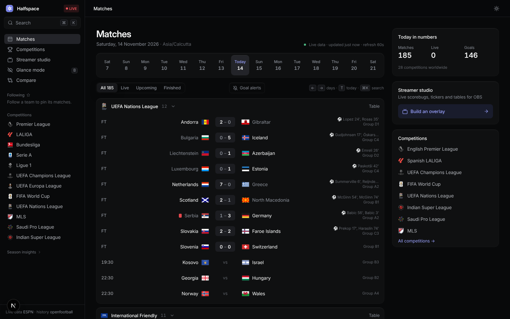
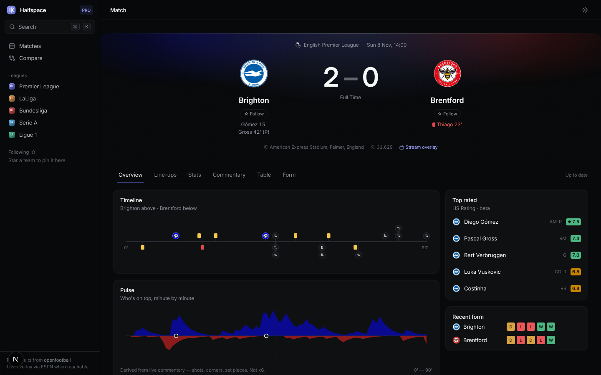
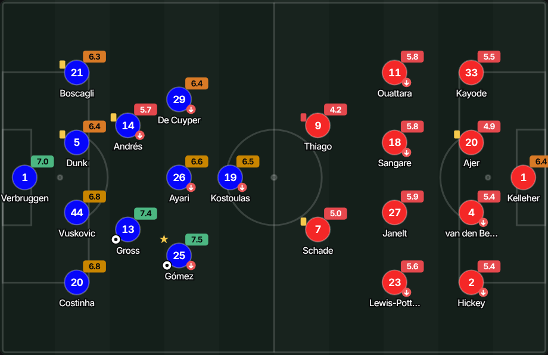
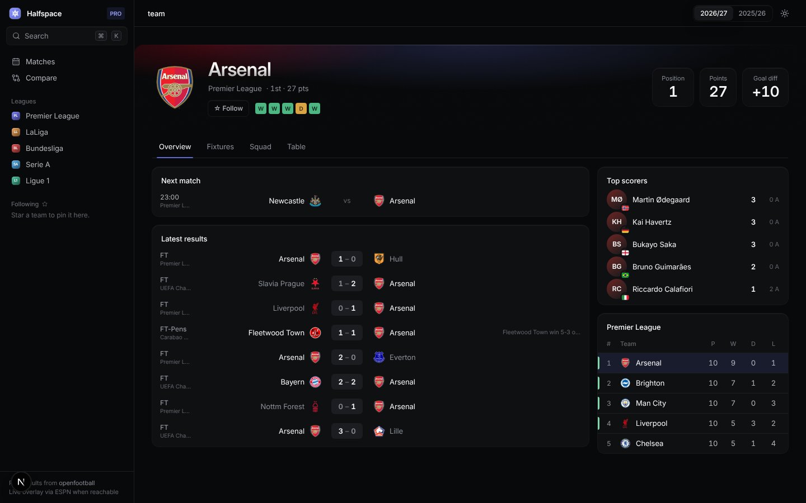
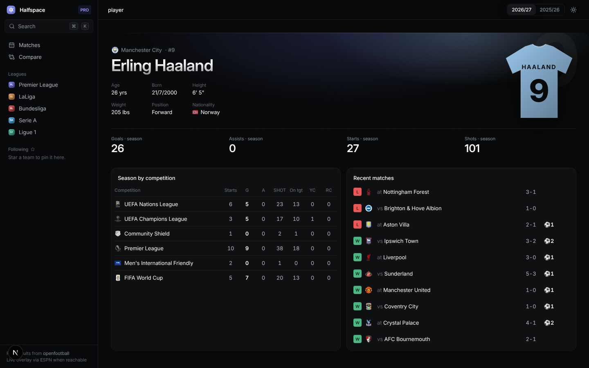
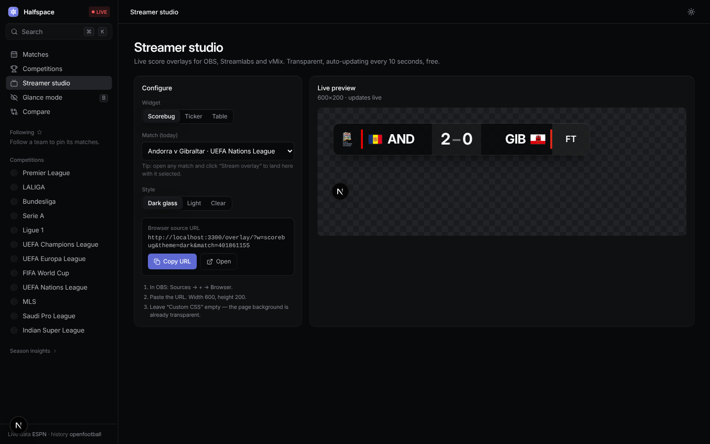
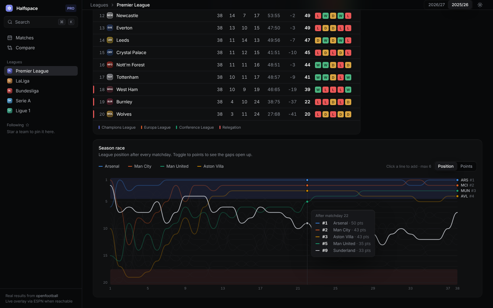
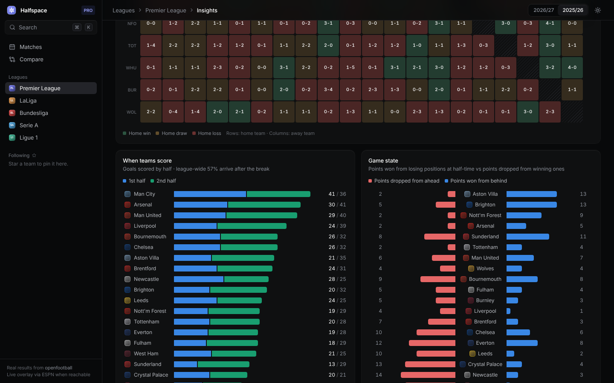
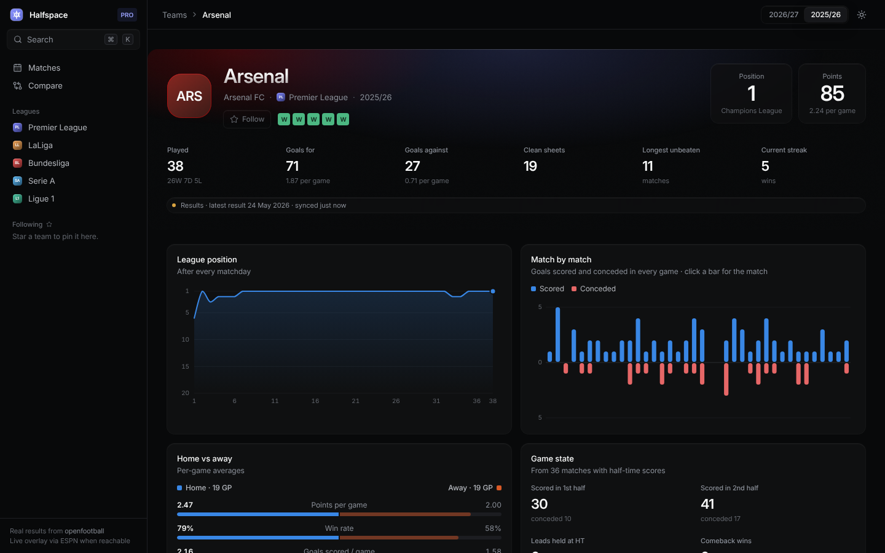
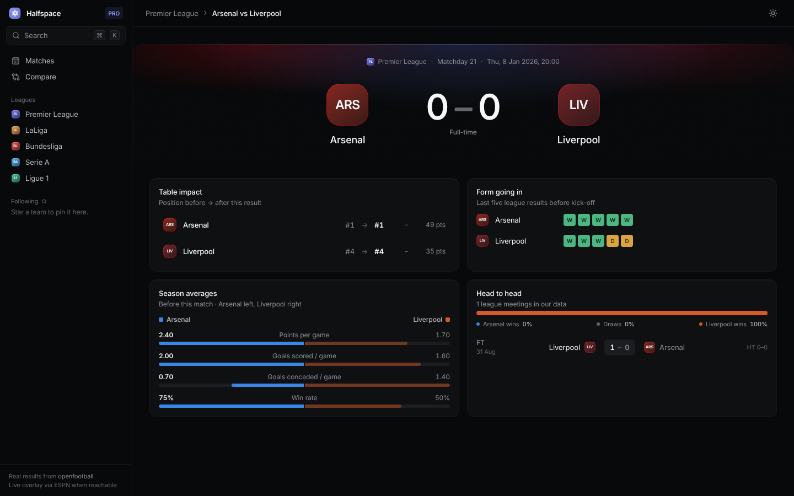

# Halfspace

A live football app for fans and streamers. It covers 220+ competitions worldwide: top leagues, European cups, the World Cup and qualifiers, the Nations League, the Euros, Copa América, friendlies, MLS, the Saudi Pro League, the Indian Super League and more.

It shows real-time scores, line-ups on a pitch, player ratings, squads and player profiles, in a Linear-style interface with motion on every chart.

**Live preview:** https://prateekbharadwaj1998.github.io/dashboard/

## What makes it different

- **Real-time with no backend.** The browser polls ESPN's public, CORS-enabled API: every 20 s while games are live, every 15 s on a live match page. It pauses when the tab is hidden and backs off on errors.
- **Streamer studio (`/studio`).** Free OBS / Streamlabs browser-source overlays with transparent backgrounds that update every 10 s:
  - a scorebug with an animated goal banner;
  - a live ticker;
  - a league table.
- **Glance mode (`B`).** A plain spreadsheet-style score list for work. The tab title carries the live score.
- **HS Rating (beta).** Our own transparent 0–10 rating built from public match stats. Tap any player to see the line-by-line breakdown. It is not an official rating.
- **Pulse.** A momentum chart built from live commentary: shots, corners and set pieces. It is honestly labelled "Not xG".
- **Goal alerts.** Opt-in browser notifications while the tab is open, filtered to the teams you follow.

## Screens

| Route | What it shows |
| --- | --- |
| `/` | Every match on a day across all competitions: a live-now rail, filters, the teams you follow first, goal flashes and toasts |
| `/match?id=` | Match centre: hero, timeline, Pulse, line-ups on a pitch with ratings, team stats, live commentary, table, form |
| `/competition?lg=` | Monthly fixtures and results, table (all groups), top scorers and assists |
| `/team?id=` | Fixtures, results in every competition, squad (age, nationality, appearances, goals, assists, cards), table position |
| `/player?id=` | Bio (age, height, nationality), season stats per competition, recent match log |
| `/competitions` | Directory of all 220 competitions by region, with search |
| `/studio`, `/overlay` | Streamer overlay builder and the chromeless overlays |
| `/glance` | Boss mode |
| `/league/{epl,laliga,…}` | Season insights for the top five leagues, built from openfootball: position race, results matrix, game state, scoreline grid |

## Run it

```bash
npm install
npm run dev        # http://localhost:3000
npm run build && npm start
npm run verify     # data-layer checks against the real data
npm run snapshot   # refresh the bundled openfootball snapshot (season insights)
npm run catalog    # refresh src/data/competitions.json from ESPN (220 competitions)
BASE_PATH=/dashboard npm run build:static   # static export to ./out (what GitHub Pages serves)
BASE_PATH=/dashboard npm run e2e            # bug-bash suite against ./out, served like Pages
```

## Tests

`npm run e2e` serves the static export under its base path, exactly as GitHub Pages does, and runs two suites:

- **Interactions** (`e2e/interact.cjs`):
  - live home with day navigation and filters;
  - match centre: 22 players on the pitch, the rating sheet, stats and commentary;
  - competition table and top scorers;
  - team squad, following a team, and opening a player from the squad;
  - player profile;
  - streamer studio, the scorebug and table overlays;
  - glance mode (`B`), ⌘K search;
  - archive analytics, theme persistence, the 404 page and the mobile drawer.

  Tests check structure and behaviour, not particular scores, so they pass on any matchday. Set `E2E_ROUTE_ESPN=1` where the test browser can't reach ESPN directly.
- **Crawl** (`e2e/crawl.cjs`): loads every exported page at desktop, mobile and tablet sizes. A page fails on a runtime error, a console error, a failed request, horizontal overflow, an empty page, a page still loading, or `NaN`/`undefined` in visible text.

The Pages workflow runs `verify`, both builds and the e2e suite on every push and every hourly rebuild. A failing check blocks the deploy.

## Live preview (GitHub Pages)

`.github/workflows/pages.yml` builds and deploys the site on every push to the default branch, and again **every hour**, so new results and live scores keep arriving without a commit. The runner has open internet access, so each build includes openfootball's latest data and the ESPN live overlay. The URL is shown on the workflow run and under *Deployments*: `https://<owner>.github.io/<repo>/`.

The same code runs in two modes:

| | Node server (`npm start`) | Static (`STATIC_EXPORT=1`) |
| --- | --- | --- |
| Pages | Pre-rendered and refreshed in the background (ISR) | Pre-rendered at build time |
| Data API | `/data/{season}/{league}.json` plus the request-time `/api/*` routes | `/data/{season}/{league}.json` as plain files |
| Live scores | Browser polls ESPN directly (15–20 s while live) | Same: browser polls ESPN directly |

**URLs:**
- The current season is unprefixed: `/league/epl`, `/team/arsenal`.
- Past seasons are prefixed: `/2025-26/league/epl`.
- Matches render from data on the client: `/match?id=…`.

## Data pipeline

**Live (in the browser):** ESPN's public soccer API.
- **Requests:** `all/scoreboard?dates=…&limit=500` is one request per day covering every competition. Each match uses `all/summary?event=`, and standings, team schedules, rosters, athletes and league statistics each have their own endpoint.
- **Caching and polling:** every response is cached in memory per URL and de-duplicated, and the cache is shared between components. Polling adapts to match state, pauses in background tabs and backs off on errors.
- **Crests:** served through ESPN's image resizer, with dark-theme variants.
- **Catalogue:** `scripts/espn-catalog.mjs` builds the map from competition ID to slug, name and logo. Scoreboard events carry only a numeric league ID.

**Season insights (at build time):** the openfootball layers below power the top-five-league analytics pages.


| Layer | Source | Role |
| --- | --- | --- |
| Base | [openfootball/football.json](https://github.com/openfootball/football.json) | Full fixture list with half-time and full-time scores. Fetched at runtime and revalidated every 30 minutes. |
| Overlay | ESPN public scoreboard API (`site.api.espn.com`) | Live scores, the match clock, finals newer than openfootball, and club crests. Current season only. Best-effort: 3.5 s timeout, all fields validated. |
| Fallback | `data/snapshot/*.json` | A committed copy of openfootball, used so the app never renders empty. |

How the layers combine (`src/lib/data/repo.ts`):
- Both providers are normalized into a single `Match` model.
- Kick-off times are converted from each league's local timezone to UTC.
- Some 0-0 results arrive as a bare `[0, 0]` array; these are normalized too.
- ESPN team names are resolved onto a curated registry of 110 clubs (`teams.ts`).
- ESPN results are merged onto openfootball fixtures by a deterministic match id.
- Every page shows a provenance badge: which sources were used, the latest result, and when the data was last synced.

If a kick-off has passed but no feed has a result yet, the match shows as **awaiting** rather than a guessed score.

## Analytics (`src/lib/derive.ts`, pure functions)

- **Standings:** tie-breaks are points, then goal difference, then goals scored. Filters for home, away and last 5.
- **Position and points race:** standings recomputed after every matchday.
- **Half-time to full-time game state:** comebacks, leads held or blown, points won from behind and points dropped from ahead.
- **Goals by half.**
- **Results matrix:** every home team against every away team.
- **Scoreline frequency:** how often each final score occurred.
- **Season splits and streaks:** home/away splits, streaks, and head-to-head across both seasons.

## Season insights screens (archive analytics)

- **Matches (`/`):** a 21-day date strip, matches grouped by league, followed teams pinned to the top, and live auto-refresh. The right rail shows the day in numbers and the league leaders.
- **League (`/league/[id]`):**
  - Overview: an animated standings table where rows re-rank with a spring when you filter, plus the season race chart.
  - Fixtures: a matchday browser.
  - Insights: the results matrix, goals by half, game state, scoreline grid and biggest wins.
- **Team (`/team/[slug]`):** a hero in the club's colours, position history, a match-by-match goals chart, home/away splits and streaks.
- **Match (`/match?id=…`):** the score, half-time to full-time, the table before and after, form going in, and head-to-head.
- **Compare (`/compare`):** two teams' profiles as mirrored bars, their position lines overlaid, and their meetings.
- **JSON API:**
  - `/data/{season}/{league}.json` (static)
  - `/api/matches?date=&tz=` (server mode only)
  - `/api/leagues/[id]/standings?season=&venue=`
  - `/api/teams/[slug]`
  - `/api/health`

## Design system

- **Tokens:** defined in `src/app/globals.css`, with a dark theme by default and a light theme. Surfaces are layered from app to panel to elevated, with a 1px inner highlight. The accent is indigo `#5E6AD2`.
- **Type:** Inter Variable with tabular numbers for scores and tables.
- **Chart palette:** six categorical series colours, checked with a palette validator for colour-blind separation and contrast in both themes. A chart's colour follows the team selected, never its rank.
- **Motion:**
  - Lines draw in.
  - In the season race, switching between position and points morphs every line in place.
  - Bars grow, numbers count up, and table rows re-rank on a spring.
  - Tooltips follow the pointer on a spring, and pages fade in on navigation.
  - All of this respects `prefers-reduced-motion`.
- **Keyboard:** `⌘K` or `/` opens the command menu. `G` then `M`, `C` or `1`–`5` navigates. `←` and `→` move between days or matchdays, and `T` jumps to today.

Branding (name, logo, league marks) is original. Club colours are used only as identity accents.

## Screenshots

| | |
| --- | --- |
|  |  |
|  |  |
|  |  |
|  |  |
|  |  |
|  |  |
