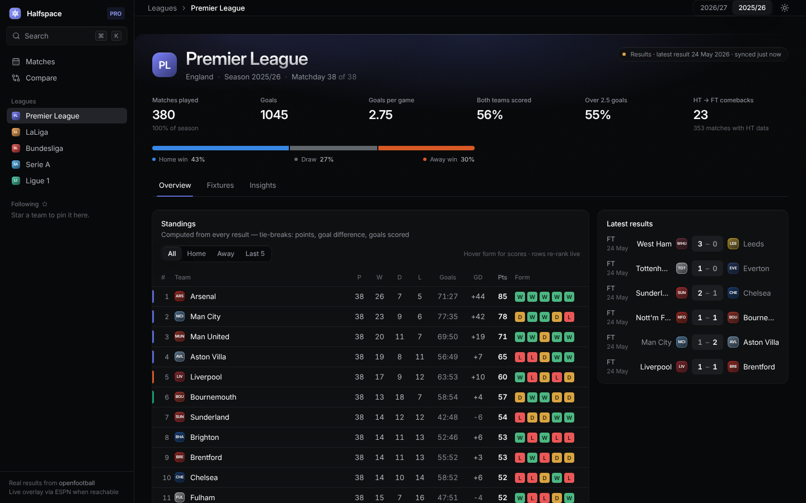
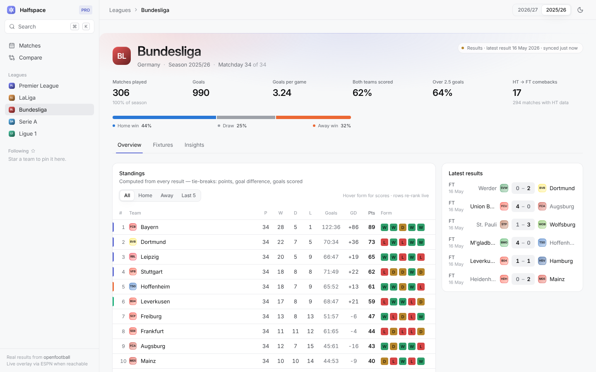

# Halfspace

A football dashboard for Europe's top five leagues. It covers live scores, tables and season analytics, in a Linear-style interface with motion on every chart.

The data is real: 3,504 fixtures across the 2025-26 and 2026-27 seasons (Premier League, LaLiga, Bundesliga, Serie A, Ligue 1). Every table and chart is computed from those results.

## Run it

```bash
npm install
npm run dev        # http://localhost:3000
npm run build && npm start
npm run verify     # data-layer checks against the real data
npm run snapshot   # refresh the bundled data snapshot
```

## Data pipeline

| Layer | Source | Role |
| --- | --- | --- |
| Base | [openfootball/football.json](https://github.com/openfootball/football.json) | Full fixture list with half-time and full-time scores. Fetched at runtime and revalidated every 30 minutes. |
| Overlay | ESPN public scoreboard API (`site.api.espn.com`) | Live scores, the match clock, finals newer than openfootball, and club crests. Current season only. Best-effort: 3.5 s timeout, all fields validated. |
| Fallback | `data/snapshot/*.json` | A committed copy of openfootball, used so the app never renders empty. |

How the layers combine (`src/lib/data/repo.ts`):
- Both providers are normalized into a single `Match` model.
- Kick-off times are converted from each league's local timezone to UTC.
- Some 0-0 results arrive as a bare `[0, 0]` array; these are normalized too.
- ESPN team names are resolved onto a curated registry of 110 clubs (`teams.ts`).
- ESPN results are merged onto openfootball fixtures by a deterministic match id.
- Every page shows a provenance badge: which sources were used, the latest result, and when the data was last synced.

If a kick-off has passed but no feed has a result yet, the match shows as **awaiting** rather than a guessed score.

## Analytics (`src/lib/derive.ts`, pure functions)

- **Standings:** tie-breaks are points, then goal difference, then goals scored. Filters for home, away and last 5.
- **Position and points race:** standings recomputed after every matchday.
- **Half-time to full-time game state:** comebacks, leads held or blown, points won from behind and points dropped from ahead.
- **Goals by half.**
- **Results matrix:** every home team against every away team.
- **Scoreline frequency:** how often each final score occurred.
- **Season splits and streaks:** home/away splits, streaks, and head-to-head across both seasons.

## Screens

- **Matches (`/`):** a 21-day date strip, matches grouped by league, followed teams pinned to the top, and live auto-refresh. The right rail shows the day in numbers and the league leaders.
- **League (`/league/[id]`):**
  - Overview: an animated standings table where rows re-rank with a spring when you filter, plus the season race chart.
  - Fixtures: a matchday browser.
  - Insights: the results matrix, goals by half, game state, scoreline grid and biggest wins.
- **Team (`/team/[slug]`):** a hero in the club's colours, position history, a match-by-match goals chart, home/away splits and streaks.
- **Match (`/match/[id]`):** the score, half-time to full-time, the table before and after, form going in, and head-to-head.
- **Compare (`/compare`):** two teams' profiles as mirrored bars, their position lines overlaid, and their meetings.
- **JSON API:**
  - `/api/matches?date=&tz=`
  - `/api/leagues/[id]/standings?season=&venue=`
  - `/api/teams/[slug]`
  - `/api/health`

## Design system

- **Tokens:** defined in `src/app/globals.css`, with a dark theme by default and a light theme. Surfaces are layered from app to panel to elevated, with a 1px inner highlight. The accent is indigo `#5E6AD2`.
- **Type:** Inter Variable with tabular numbers for scores and tables.
- **Chart palette:** six categorical series colours, checked with a palette validator for colour-blind separation and contrast in both themes. A chart's colour follows the team selected, never its rank.
- **Motion:**
  - Lines draw in.
  - In the season race, switching between position and points morphs every line in place.
  - Bars grow, numbers count up, and table rows re-rank on a spring.
  - Tooltips follow the pointer on a spring, and pages fade in on navigation.
  - All of this respects `prefers-reduced-motion`.
- **Keyboard:** `⌘K` or `/` opens the command menu. `G` then `M`, `C` or `1`–`5` navigates. `←` and `→` move between days or matchdays, and `T` jumps to today.

Branding (name, logo, league marks) is original. Club colours are used only as identity accents.

## Screenshots

| | |
| --- | --- |
|  |  |
|  |  |
|  |  |
